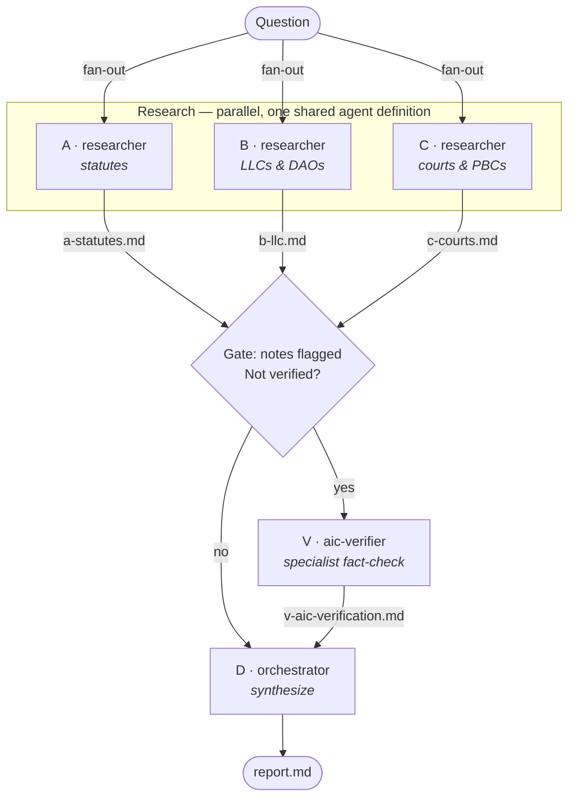

# AI-Corp

Multi-agent research on how Delaware treats AI-run corporations, built as a **graph** of Claude Code agents:

- **Nodes** are agents.
- **State** is a set of notes files, one per agent.
- **Edges** control the order agents run in.

## Architecture



## Layout

```
AI-Corp/
├── README.md                 architecture (this file)
├── GUIDE.md                  concepts, rules of thumb, lessons from the run
├── .claude/agents/           reusable agent definitions
│   ├── researcher.md         general researcher; its scope is given in the task
│   └── aic-verifier.md       AIC specialist fact-checker
└── delaware-ai-corps/        one run = one folder
    ├── graph.md              ← start here: each node's scope, the edges, the run log
    ├── a-statutes.md  ┐
    ├── b-llc.md       │ notes: each node writes only its own file
    ├── c-courts.md    │
    ├── v-aic-verification.md ┘
    └── report.md             final synthesis
```

## Design choices

- **One researcher definition, many scopes.** The research nodes share the same rules (sourcing, separating verified from uncertain, output format), so those rules live in a single file, `researcher.md`. Each node's scope is one row in the run's `graph.md`. A change to the rules applies to every node, and adding a node means adding a row instead of writing a new agent file.
- **Specialists get their own file.** `aic-verifier` uses a different method (a ranking of source types, fixed verdict labels, standing questions), so it has its own definition.
- **Notes live alongside the report.** Each run is a single flat folder, with no separate `state/` subfolder. The letter prefix on each notes file matches its node ID in `graph.md`.
- **The orchestrator is the main Claude Code session,** not an agent file. It reads `graph.md`, starts the nodes, waits for them to finish and writes `report.md`.

## Running a new topic

1. Copy `delaware-ai-corps/graph.md` into a new folder and rewrite each node's scope.
2. In Claude Code, ask: *"Run the graph in `<folder>/graph.md`."*
