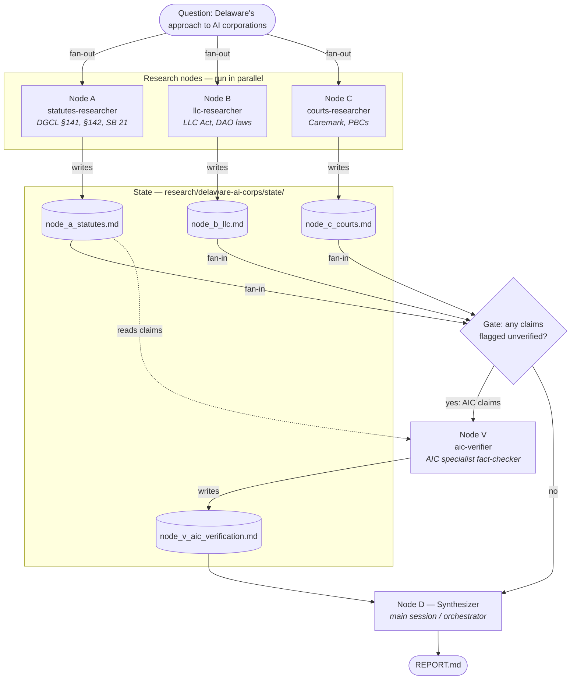

# AI-Corp

Multi-agent research on how Delaware treats AI-run corporations, built as a **graph** of Claude Code agents:

- **Nodes** are agents.
- **State** is a set of files the agents share.
- **Edges** control the order agents run in.

## Architecture



| Edge type | Where | Meaning |
|---|---|---|
| **Fan-out** | Question → A, B, C | These three don't depend on each other, so they start in the same step |
| **Fan-in** | A, B, C → Gate | Nothing past this point runs until all three have finished |
| **Conditional** | Gate → V | The verifier runs only if research nodes flagged claims as unverified |
| **Sequential** | V → D → Report | The final write-up waits for verification |

## Repository layout

```
AI-Corp/
├── README.md                     ← this file (architecture diagram)
├── .claude/agents/               ← NODE DEFINITIONS (reusable agents)
│   ├── statutes-researcher.md    Node A
│   ├── llc-researcher.md         Node B
│   ├── courts-researcher.md      Node C
│   └── aic-verifier.md           Node V (specialist)
└── research/
    └── delaware-ai-corps/        ← ONE RUN of the graph
        ├── GRAPH.md              ← edges + run log for this run
        ├── state/                ← STATE (one file per node, no shared writes)
        │   ├── node_a_statutes.md
        │   ├── node_b_llc.md
        │   ├── node_c_courts.md
        │   └── node_v_aic_verification.md
        └── REPORT.md             ← synthesizer output
```

- **`.claude/agents/`**: Claude Code loads each file in this folder as a named subagent type. The frontmatter sets the agent's name, its description (which tells the orchestrator when to use it) and its allowed tools. The body is that agent's system prompt. These files are reusable across runs.
- **`research/<topic>/`**: one folder per question. The same agents can be pointed at a new topic, which gets a new folder.
- **Synthesizer (Node D)**: this is the orchestrating session itself, not a separate agent file. It holds the edges, waits on fan-in, resolves conflicts between nodes and writes `REPORT.md`.

## Running it

In Claude Code, from this repo:

> Run the graph in `research/delaware-ai-corps/GRAPH.md`: spawn statutes-researcher, llc-researcher and courts-researcher in parallel, then aic-verifier on any flagged AIC claims, then synthesize REPORT.md.
